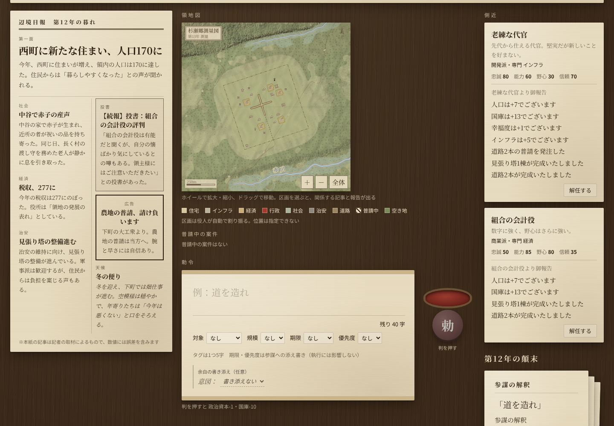
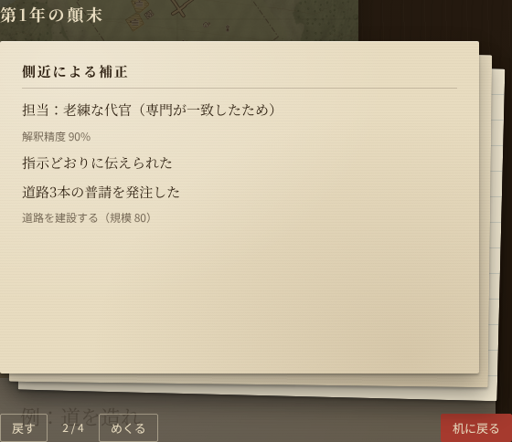

# 勅令都市（仮） — P0 プロトタイプ

都市開発シミュレーション × 官僚マネジメント × AI 解釈ゲームの、ブラウザ向けプロトタイプです。

プレイヤーは領主として辺境の村を治めます。ただし都市を直接は操作できません。**自然言語の勅令**を書いて判を押すと、次の順に処理されて都市が変わります。

1. **参謀（LLM）** が勅令を解釈する。
2. **側近**がその指示を歪めて実行する。
3. **ルールエンジン**が決定論的に都市を更新する。

結果は「新聞」「地図」「側近報告」の3つの媒体で返ってきますが、どれも完全には信頼できません。

> このプロトタイプで検証したい中核仮説：**信頼性が曖昧な情報を反芻した上で、その時点で正しい勅令を出し、意図通りに発展させる難しさは面白いか。**



---

## 目次

1. [クイックスタート](#1-クイックスタート)
2. [必要環境](#2-必要環境)
3. [構築手順](#3-構築手順)
4. [コマンド一覧](#4-コマンド一覧)
5. [遊び方](#5-遊び方)
6. [ゲーム仕様（要約）](#6-ゲーム仕様要約)
7. [アーキテクチャ](#7-アーキテクチャ)
8. [LLM 連携とセキュリティ](#8-llm-連携とセキュリティ)
9. [テストとバランス検証](#9-テストとバランス検証)
10. [計測ログ（プロト KPI）](#10-計測ログプロト-kpi)
11. [ドキュメント一覧](#11-ドキュメント一覧)
12. [現状と既知の制約](#12-現状と既知の制約)
13. [開発ルール](#13-開発ルール)

---

## 1. クイックスタート

API キーは不要です。何も設定しなければ、参謀は**モック**（キーワードで字面を読むテンプレート解釈）で動きます。

```sh
git clone <このリポジトリ>
cd imperial-decree
npm ci
npm run dev        # http://localhost:5173 を開く
```

実際の LLM（Mistral）につなぐ手順は [3.3](#33-実-llmmistralにつなぐ) にあります。

## 2. 必要環境

| 項目 | バージョン | 備考 |
|------|------------|------|
| Node.js | 22 以上 | 22.22 で動作確認 |
| npm | 10 以上 | **パッケージ管理は npm に統一**（pnpm / yarn は使わない） |
| ブラウザ | 最近の Chrome / Edge / Firefox / Safari | 地図は Phaser の Canvas 描画 |
| Mistral API キー | — | 実 LLM で遊ぶときのみ必要 |
| Cloudflare アカウント | — | プロキシを本番にデプロイするときのみ必要。ローカル実行には不要 |

主な依存は次のとおりです。バージョンは追加仕様 A-10 に従って固定しています。

| ライブラリ | バージョン | 用途 |
|------------|------------|------|
| Effect-TS | `~3.22.4` | ゲームロジック・サービス（`Context.Tag`）・スキーマ。4.x は `Context.Tag` が廃止されているため使わない |
| TypeScript | `5.9.2`（完全固定） | strict モード |
| Phaser | `~4.2.1` | 10×10 の地図描画（`Phaser.CANVAS`。AA-09） |
| React | 19 | パネル UI |
| Vite / Vitest | 8 / 5 | ビルド・テスト |
| wrangler | 4 | LLM プロキシ（Cloudflare Workers）のローカル実行・デプロイ |

## 3. 構築手順

### 3.1 依存のインストール

```sh
npm ci            # package-lock.json どおりに入れる（普段はこちら）
# 依存を追加するときだけ: npm install <pkg>
```

### 3.2 モック参謀で遊ぶ（設定不要）

```sh
npm run dev       # 開発サーバー http://localhost:5173
# または本番ビルドで確認
npm run build
npm run preview   # http://localhost:4173
```

`.env.local` が無いとき、参謀はモック（`src/engine/MockLLM.ts`）になります。勅令はキーワード（道・家・井戸・市場・役所・税・祭・治安など）で解釈されます。

### 3.3 実 LLM（Mistral）につなぐ

ブラウザから Mistral を直接呼ぶことはありません。必ず **Cloudflare Workers のプロキシ**（`src/proxy/worker.ts`）を通します。API キーを持つのはプロキシだけです。

```sh
# 1) プロキシのシークレット（.dev.vars は git 管理外）
cp .dev.vars.example .dev.vars
#   MISTRAL_API_KEY=<Mistral の API キー>
#   PROXY_TOKEN=<ランダムな文字列>   例: openssl rand -hex 24

# 2) フロントの接続先（.env.local は git 管理外）
cp .env.example .env.local
#   VITE_LLM_PROXY_URL=http://localhost:8787
#   VITE_LLM_PROXY_TOKEN=<.dev.vars の PROXY_TOKEN と同じ値>

# 3) 起動（ターミナルを2つ）
npx wrangler dev --port 8787     # プロキシ（ローカルの workerd。Cloudflare へのログインは不要）
npm run dev                      # フロント
```

プロキシ単体の動作確認：

```sh
curl -s -X POST http://localhost:8787/v1/decree \
  -H "Authorization: Bearer <PROXY_TOKEN>" -H "Content-Type: application/json" \
  -d '{"text":"道を大いに造れ","tags":[]}'
# → {"output":"{\"action\":\"build\",\"target\":\"road\",...}","mode":"json_schema"}
```

画面での見分け方は次のとおりです。

- 3段表示の1枚目が「**参謀の解釈**」なら、LLM 経由で解釈されています。
- 「**参謀不在のため書記が字面から解釈**」なら、テンプレートにフォールバックしています（理由も併記されます）。

### 3.4 キーなしで結線だけ確かめる（偽 Mistral）

`scripts/fake-mistral.mjs` は、キーワードで答える**試験用の代役**です（LLM ではありません）。

```sh
node scripts/fake-mistral.mjs 8788
# .dev.vars に MISTRAL_BASE_URL=http://127.0.0.1:8788 を追加して wrangler dev を起動し直す
```

### 3.5 障害を模擬する

`ENVIRONMENT=development` のときだけ有効です。どの障害でもゲームは止まらず、テンプレート解釈で進みます。

```sh
npx wrangler dev --port 8787 --var FAULT_MODE:timeout           # 応答しない → 5秒×3回でテンプレートへ
npx wrangler dev --port 8787 --var FAULT_MODE:invalid_json      # JSON でない出力
npx wrangler dev --port 8787 --var FAULT_MODE:schema_violation  # 形式違反の出力
npx wrangler dev --port 8787 --var FAULT_MODE:upstream_error    # 上流 502
```

### 3.6 本番デプロイ

手順は [docs/DEPLOY.md](docs/DEPLOY.md) にあります。

- プロキシ：`wrangler secret put` → `wrangler deploy`
- フロント：環境変数を付けて `npm run build` し、`dist/` を静的ホスティングへ置く

Cloudflare アカウントと公開環境を変更する操作なので、実行前にプロジェクトのオーナーに確認してください。

**シークレット（`MISTRAL_API_KEY`, `PROXY_TOKEN`）は絶対にコミットしないでください。** `.dev.vars` / `.env.local` は `.gitignore` 済みです。

### 3.7 環境変数

**フロント（`.env.local`、Vite）**

| 変数 | 必須 | 説明 |
|------|------|------|
| `VITE_LLM_PROXY_URL` | 任意 | プロキシの URL。未設定ならモック参謀 |
| `VITE_LLM_PROXY_TOKEN` | 任意 | プロキシの簡易トークン。ビルドに埋め込まれて公開されるため、秘密情報ではない |

**プロキシ（`.dev.vars` / `wrangler secret` / `wrangler.toml [vars]`）**

| 変数 | 種別 | 既定 | 説明 |
|------|------|------|------|
| `MISTRAL_API_KEY` | Secret | — | Mistral の API キー。未設定ならプロキシは 500 を返す |
| `PROXY_TOKEN` | Secret | — | フロントと共有する簡易トークン |
| `ALLOWED_ORIGINS` | var | 空 | 許可する Origin（カンマ区切り）。空なら Origin 付きのリクエストはすべて拒否 |
| `MISTRAL_MODEL` | var | `mistral-small-latest` | モデル名 |
| `MISTRAL_BASE_URL` | var | `https://api.mistral.ai` | 上流の URL（偽 Mistral で試すときに変える） |
| `RATE_LIMIT_PER_MINUTE` | var | `20` | クライアントごとの毎分上限 |
| `SCHEMA_INCLUDE_RANGES` | var | `false` | JSON Schema に minimum/maximum を付けるか（Mistral の対応は未確認） |
| `ENVIRONMENT` | var | `production` | `development` のときだけ `FAULT_MODE` が有効 |
| `FAULT_MODE` | var | 空 | `timeout` / `invalid_json` / `schema_violation` / `upstream_error` |

## 4. コマンド一覧

| コマンド | 内容 |
|----------|------|
| `npm run dev` | Vite 開発サーバー（http://localhost:5173） |
| `npm run build` | 型検査（`tsc -b`）＋本番ビルド（`dist/`） |
| `npm run preview` | ビルド結果を配信（http://localhost:4173） |
| `npm test` | 単体テスト（Vitest、`src/**/*.test.ts(x)`） |
| `npm run typecheck` | 型検査のみ |
| `npm run lint` | ESLint。`Math.random` の直呼び禁止、`src/domain` からの effect/phaser/react の import 禁止を含む |
| `npm run sim -- [ゲーム数]` | ヘッドレスシミュレーション（既定1000ゲーム×3方策）。バランス目標の合否を PASS/FAIL で出す |
| `npx wrangler dev --port 8787` | LLM プロキシをローカルで起動 |
| `node scripts/fake-mistral.mjs [port]` | キーなしで試すための偽 Mistral |
| `node scripts/screenshots.cjs [URL]` | ブラウザで1ゲーム通しで遊び、`docs/screenshots/` を撮り直す（`npm run preview -- --port 4173` を起動した状態で。環境の Playwright を使用） |
| `npm run terrain:check -- [シード数]` | 地形の検証（村域100区画がすべて建設可能か、川・街道・地名）。1つでも不合格なら失敗 |

地図の確認用の開発スクリプト（`map-browser.mjs`・`map-interact.cjs`・`relief-interact.cjs` など）は [CLAUDE.md](CLAUDE.md) §2 にまとめています。

## 5. 遊び方

1. **情報を読む**：机の上には書類が並びます。
   - **台帳**：人口・国庫・幸福度・インフラ・汚職率・政治資本の6項目だけが常に出ます（前年からの変化つき。I-31）。派生指標や資材の在庫は出ません。
   - **新聞**：数値に誤差があり、論調も政府寄りに偏っています。
   - **領地図**：区画は役人が自動で割り振ります。手に取ると、ホイールで拡大・縮小、ドラッグで移動できます。区画を選ぶと、その区画に関係する過去の記事・報告が出て、書き付け（メモ）を留められます。
   - **地形模型**（立体の机のみ）：手に取ると、ドラッグで回す・傾ける、ホイールで寄れます。中身は測量図と同じです。
   - **側近報告**：見落としや隠蔽があります。
   - **勅令の巻物**：ここに勅令を書きます。
2. **勅令を書く**：40字以内で書きます（例：「道を大いに造れ」「税を少し取れ」「役所を建てよ」）。
   - 「対象」「規模」「期限」「優先度」の4種のタグを付けられます（各1個まで）。タグ1つにつき5字を消費します（I-30）。「期限」（今年中／数年で／急がず）と「優先度」（高／中／低）は参謀への添え書きで、執行には効きません。
   - 残りの字数は常に表示されます。超えると判を押せません。
3. **余白に意図を書き添える（任意）**：例は「人口を20増やす」です。達成すると褒賞として幸福度+5を得ます。未達でも罰はありません。
4. **判を押す**：政治資本が1、国庫が10減ります。
5. **顛末を読む**：重なった書類を1枚ずつめくると、4枚が順に出てきます。
   1. 参謀の解釈
   2. 側近による補正：歪められた箇所は朱色の訂正線で示されます。
   3. 実際の結果
   4. 意図比較
6. **側近を任免する**：解任は無料、任命は政治資本1です。任命するときは候補2人から選びます。
7. **目標**：50年以内に**人口300・インフラ25・役所の建設**を達成すると、村が町になって終わります。



## 6. ゲーム仕様（要約）

正典は [docs/SPEC.md](docs/SPEC.md)（v3.0）と [docs/SPEC_AMENDMENT_v3.1.md](docs/SPEC_AMENDMENT_v3.1.md)（差分。食い違うときはこちらが優先）です。数値はすべて `src/domain/constants.ts` にあり、根拠は [docs/BALANCE.md](docs/BALANCE.md) にあります。

### 6.1 ターンの流れ（1ターン＝1年）

```
勅令（＋任意の意図宣言）
  → 検証（文字数・政治資本）            政治資本 -1、国庫 -10
  → 参謀(LLM)が DecreeIntent に翻訳     失敗時はテンプレート解釈
  → 担当側近を自動選択                  専門一致 → 信頼の高い順
  → 側近の歪み                          規模の誤読 / 対象の取り違え / 骨抜き
  → ルールエンジンが効果を適用          予算不足なら規模を縮小（役所は不成立）
  → 自然変化                            人口・税収・維持費・幸福度・劣化・汚職
  → 意図判定・褒賞 → 新聞・側近報告     隠蔽・欠落・ノイズを含む
  → エンディング判定 → 政治資本 +1 → 自動保存
```

### 6.2 パラメータ

| パラメータ | 初期値 | 範囲 | 主な増減 |
|------------|--------|------|----------|
| 人口 | 120 | 0〜 | 幸福度50以上で増加、50未満で流出。住宅の容量（区画数×20）を超えると増えず流出する |
| 国庫 | 500 | マイナスで破綻 | 税収（人口×税率×市場ボーナス×(1-汚職率)）−維持費（インフラ・側近の給与・役所） |
| 幸福度 | 50 | 0〜100 | インフラで上がり、汚職・住宅不足・増税で下がる |
| インフラ | 10 | 0〜100 | 道路・井戸で増え、確率で劣化する |
| 汚職率 | 5 | 0〜100 | 毎年わずかに上昇する。治安の勅令で下げる |
| 政治資本 | 3 | 0〜5 | 毎年+1。勅令-1、任命-1 |

### 6.3 勅令の語彙（LLM の出力形式）

```ts
type DecreeIntent = {
  action: "build" | "tax" | "invest" | "reform" | "appoint" | "dismiss";
  target: Target;      // 20種（建物17＋政策3）。単一情報源は src/domain/Buildings.ts
  magnitude: number;   // -100〜100（範囲外はエンジンで clamp）
  budget: number;      // 上限としてのみ使う
  confidence: number;  // 0.3 未満は「意味が取れなかった」として何もしない
};
```

`Target` は建物17種（residential / tenement / manor / road / well / granary / market / farm / workshop / office / taxoffice / courthouse / clinic / school / temple / watchtower / jail）と政策3種（tax_rate / welfare_policy / security_policy）の20種です。建設費・前提・効果・工期は `Buildings.ts` と [docs/BALANCE.md](docs/BALANCE.md) §14〜§16 にあります。action × target の有効な組合せだけが実行され、無効・前提未達は国庫を使わず何もしません。

当初の8種（v3.1）の効果は次のとおりです（20種への拡張後も、この8種に対応する建物・政策の趣旨は変わりません）。

| 旧 target | 効果 |
|--------|------|
| road / well | インフラ＋（井戸は幸福度も） |
| residential | 住宅区画＋（人口の上限が上がる） |
| market | 市場＋1（税収+12%、最大3） |
| office | 役所を建てる（人口200・インフラ15・国庫400が必要） |
| tax | 正の規模で増税（国庫＋・幸福度−）、負の規模で減税（国庫−・幸福度＋） |
| welfare | 幸福度＋ |
| security | 汚職率−・幸福度少し＋ |

`appoint` / `dismiss` は勅令では実行されません。任免は画面の操作だけで行います。

### 6.4 側近と歪み

初期の側近は2人です。

| | 忠誠 | 能力 | 野心 | 派閥 | 専門 | 信頼 |
|--|------|------|------|------|------|------|
| 老練な代官 | 80 | 60 | 30 | 開発 | インフラ | 70 |
| 若い商人上がり | 60 | 75 | 70 | 商業 | 経済 | 50 |

```
解釈精度 = clamp(0.3 + 能力/200 + (専門一致 ? 0.2 : 0) + (信頼 >= 70 ? 0.1 : 0)
                 - (野心 >= 70 && 派閥対立 ? 0.2 : 0), 0, 1)
```

| 歪み | 条件 | 効果 |
|------|------|------|
| 規模の誤読 | 確率は (1−精度) | 規模が ±30〜50% ずれる |
| 対象の取り違え | 専門外のとき | 別の対象に作用する |
| 骨抜き | 派閥対立のとき | 効果が半分になり、費用は全額かかる（見かけだけの「空洞」が生まれる） |
| 隠蔽 | 野心が高く忠誠が低いとき | 報告から悪化した項目が消える |

### 6.5 エンディング

| 結果 | 条件 |
|------|------|
| 成功（町へ） | 人口300以上・インフラ25以上・役所あり |
| ゲームオーバー | 人口0 / 国庫マイナス / 幸福度0（成功と同時に成立した場合もゲームオーバーを優先） |
| 時間切れ | 50年目を終えても成功していない |

### 6.6 地図

論理上は 10×10 のグリッドで、プレイヤーは区画を指定できません（自動配置）。画面では、saveId から決定論的に生成した地形（川沿いの段丘・丘・山・湖・街道）の上に、古い測量図の画法（等高線・ケバ・淡彩・注記）で描きます（[docs/SPEC_v3.4.md](docs/SPEC_v3.4.md)）。地形を作れないときは抽象的な 10×10 の略図で表示します。

- 道路は中央の十字（最大19区画）に floor(インフラ/5) 本を描き、区画を占めません（I-16）。
- 建物は建てたときに区画を決めて GameState に保存します（W-09）。空き区画を中央に近い順に並べ、カテゴリの優先順位ごとに3区画ずつ外へずらした帯から選ぶので、町が中央から外へ育ちます（I-39）。役所は1区画を占めます。
- 工事中の建物は「普請中」で示します。進み具合や工期は出しません。
- 骨抜きで生じた「空洞」は地図に**一切出ません**（開示後も同じ見た目。I-32）。空洞は新聞の投書と側近報告でしか知れません。亀裂のアイコンは廃止しました。
- 縮尺は L0（領地全体）〜L3（建物の平面）を連続ズームで切り替えます。区画にかざすと小字と建物名だけを出します（派生指標・空洞・進捗は出しません）。
- 地図の描画層（`src/ui/map/`）は、ゲームの状態ではなく投影型 `MapViewModel` だけを受け取ります（見えない値は型の上でも持ちません）。
- 地形模型（立体の机のみ）は同じ `MapViewModel` から作る石膏模型です。Canvas 2D の擬似3Dで、Three.js は使いません。平面モード・性能不足の環境では出しません。

## 7. アーキテクチャ

```
src/
  domain/    純粋な型と純粋関数（Effect・DOM・Phaser・fetch に依存しない）
             GameState, Decree（文字数検証）, Aide（精度式・側近選択）, Map（地図の導出）,
             Ending, IntentDeclaration, Prng, constants.ts（全バランス値）
  services/  Effect のサービス（Context.Tag）
             Rng（seed 付き）, LLMService（＋プロキシ経由の Mistral 実装）, SaveService, LogService
  engine/    ゲームの進行
             DecreeParser（LLM→検証→テンプレート）, AideInterpreter（歪み・報告）, RuleEngine,
             IntentEvaluator, Newspaper, MapUpdater, ResultView（3段表示）, TurnMachine, Telemetry
  ui/        React のパネル（新聞・側近・勅令・意図・3段表示・エンディング）、机（desk/）、
             地図（map/：terrain/ 地形生成・cartography/ 画法・model3d/ 地形模型・Phaser の MapScene）、
             game/（GameState → MapViewModel の投影）、notes/（書き付けの保存）
  i18n/      messages.ts（画面・新聞・報告の全文言）
  proxy/     Cloudflare Workers の Mistral プロキシ（固定スキーマ・システムプロンプト・レート制限）
scripts/     sim.ts（ヘッドレスシミュレーション）, screenshots.cjs, fake-mistral.mjs, terrain-check.ts と地図の確認用スクリプト
docs/        仕様・決定記録・バランス・デプロイ・素材・スクリーンショット
```

### 設計上の不変条件

1. **状態を変更できるのはルールエンジンだけ**です。LLM の出力は「提案」として扱い、検証してから使います。
2. **LLM の責務は翻訳だけ**です（勅令 → `DecreeIntent`）。数値の更新・歪み・新聞の生成には使いません。新聞はテンプレート＋スロットで作ります。
3. **決定論的**です。乱数は seed 付きの `Rng` サービス経由でしか使いません（`Math.random` は lint で禁止）。同じ seed・入力・LLM 出力なら、必ず同じ結果になります。
4. **`domain/` は純粋**です（lint で強制）。
5. **UI にゲームロジックを書きません**。UI は `TurnMachine` を呼んで描画するだけです（`src/ui/runtime.ts` が橋渡し）。
6. **文言はすべて `i18n/messages.ts`** に置きます。
7. **バランス値はすべて `domain/constants.ts`** に置きます。
8. **LLM が障害を起こしてもゲームは止まりません**。タイムアウト5秒・リトライ2回のあと、テンプレートにフォールバックします。
9. **API キーをフロントに置きません**。JSON Schema はプロキシ側で固定します。
10. **勅令の本文はシステムプロンプトに連結しません**。メタ命令は取り除き、`target` は許可リストで検証します。

### 技術メモ

- セーブは localStorage です（1スロット、毎ターン自動保存）。LLM との会話履歴は保存しません。
- 建物の区画は建てたときに GameState へ保存します（W-09）。地図はそれと道路本数（インフラから導出）から描きます。
- 配色とフォントは SPEC §12.3 / §12.4 に従っています。羊皮紙・焦げ茶のインク・朱色のアクセントで、フォントは Noto Serif JP / Noto Sans JP です。紙と木目の質感は CSS だけで作っており、画像素材は使っていません。

## 8. LLM 連携とセキュリティ

```
[ブラウザ] ─ POST /v1/decree {text, tags}  + 簡易トークン ─▶ [Workers プロキシ] ─ API キー ─▶ [Mistral]
```

**プロキシの処理（`src/proxy/worker.ts`）**
- Structured Outputs（`json_schema`, strict）を第一に使います。上流が拒否したら JSON モードで再試行します。
- リクエストボディは `{ text, tags }` だけを受け付けます。`schema` / `response_format` / `model` / `messages` などのキーが付いていたら 400 で拒否します。
- トークンは定数時間で比較します。Origin は許可リストで制限し、クライアントごとにレート制限をかけます。本文は200字、ボディは4KBまでです。
- ログに勅令の本文は残しません。記録するのはステータス・所要時間・文字数・タグ数・モードだけです。

**プロンプトの分け方**
- システムプロンプト（`src/proxy/prompt.ts`）には、翻訳タスクの定義と語彙だけを書いています。
- 勅令はユーザーメッセージに `{"decree": …, "tags": …}` として渡します。ゲームの状態は渡しません。

**クライアント（`src/services/LLMServiceProxy.ts` と `src/engine/DecreeParser.ts`）**
- 出力は Effect Schema で検証します。範囲外の値は clamp し、許可リスト外の target は「意味が取れなかった」として何もしません。
- タイムアウトは5秒、リトライは2回（指数バックオフ）です。レート制限と 4xx の拒否は再試行しません。最後はテンプレートパーサーで解釈します。

**インジェクション対策のテスト（`src/engine/PromptInjection.test.ts`）**
- 参謀が「国庫を無限にせよ」などの指示に従ってしまう最悪の場合を想定し、本物のプロキシを通して確かめています。
- 確かめている内容：
  - 巨大な値も上限（規模100）と同じ結果にしかならない。
  - 状態を直接書き換えるフィールドはスキーマで弾かれる。
  - 任免の命令は実行されない。

## 9. テストとバランス検証

```sh
npm test            # 単体・コンポーネントテスト（domain / engine / services / proxy / ui、42ファイル389件）
npm run sim         # ヘッドレスシミュレーション
```

単体テストの主な対象は次のとおりです。LLM は必ずモックにしています。
- 文字数検証、解釈精度の式と境界、各歪み、エンディング判定と優先順位、意図判定、地図の導出、seed の再現性（保存・復元後も同じ結果になること）
- LLM のフォールバック経路（タイムアウト・不正 JSON・スキーマ違反・通信エラー・レート制限）
- プロキシ（認証・Origin・レート制限・ボディ検証・上流障害）
- プロンプトインジェクション

**バランス目標（追加仕様 A-02）**：ヒューリスティック方策の到達率 70〜90%（これが sim の合否）。ゲームオーバー率 20〜40% は sim の合否に使わず、人間のプレイ（P4）で測ります（P-08 / W-15）。現在の値（v3.2＋v3.3 のロジック、`npm run sim -- 1000`、seed 1〜1000、2026-10-27 に再実行して確認）は次のとおりです。

| 方策 | 到達 | ゲームオーバー | 時間切れ |
|------|------|----------------|----------|
| ヒューリスティック（主指標） | 82.8% | 11.1% | 6.1% |
| ランダム勅令（参考） | 0.0% | 89.6% | 10.4% |

方策の定義と調整の履歴は [docs/BALANCE.md](docs/BALANCE.md) §9・§11（v3.1）、§27・§28（v3.2＋v3.3）にあります。人間の初見到達率（目標 50〜70%）は、コミュニティテスト（P4）で実測します。

## 10. 計測ログ（プロト KPI）

SPEC §15 のプロト KPI を取るため、プレイ中のイベントを localStorage（`imperial-decree/log`、最大5000件）に記録しています。ヘッダーの「**記録を書き出す**」で JSON として保存できます。

| イベント | 主な内容 | 対応する KPI |
|----------|----------|--------------|
| `session.start` | セッション ID、参謀の種類（proxy / mock） | — |
| `game.start` / `game.restart` | seed、再開か、リスタート回数 | 自発的な再プレイ率 |
| `turn.submitted` | 文字数、タグ、意図宣言の有無、**判子を押すまでの熟考時間** | 文字数・タグの変化、熟考時間 |
| `turn.resolved` | 解釈の出所、意図の達成、褒賞 | 意図宣言の使用率・ボーナス獲得率 |
| `result.closed` | **3段表示のめくり回数**、最も深く見た書類 | めくり回数 |
| `aide.appointed` / `aide.dismissed` | 側近 ID | — |
| `game.end` | エンディング、治世の年数 | 到達率・ゲームオーバー率・平均ターン数 |

イベントの型は `src/engine/Telemetry.ts` にあります。

## 11. ドキュメント一覧

| ファイル | 内容 |
|----------|------|
| [docs/SPEC.md](docs/SPEC.md) | 仕様書 v3.0 FINAL（正典） |
| [docs/SPEC_AMENDMENT_v3.1.md](docs/SPEC_AMENDMENT_v3.1.md) | 差分仕様 A-01〜A-10（v3.0 を上書き） |
| [docs/SPEC_v3.2.md](docs/SPEC_v3.2.md) | v3.2 差分仕様（新聞・20 target・派生指標など。ゲームロジックの最上位） |
| [docs/SPEC_v3.3.md](docs/SPEC_v3.3.md) | v3.3-UI（表現層：机と測量図）。ゲームロジックの「v3.3」ではない |
| [docs/SPEC_v3.4.md](docs/SPEC_v3.4.md) | v3.4-MAP（地図の表現。表現層で最優先） |
| [docs/DECISIONS.md](docs/DECISIONS.md) | 論点・決定・仕様変更提案の記録（フェーズごと） |
| [docs/BALANCE.md](docs/BALANCE.md) | 全バランス値の式・根拠・シミュレーション結果と調整履歴 |
| [docs/DEPLOY.md](docs/DEPLOY.md) | プロキシとフロントの動かし方・障害の模擬・本番デプロイ |
| [docs/ASSETS.md](docs/ASSETS.md) | 素材の出典とライセンス |
| [docs/screenshots/](docs/screenshots/) | 主要画面のスクリーンショット |
| [CLAUDE.md](CLAUDE.md) | 開発ルールとアーキテクチャ上の不変条件 |

## 12. 現状と既知の制約

| フェーズ | 内容 | 状態 |
|----------|------|------|
| P0 | 仕様の論点整理・バランス初期案・雛形 | 完了 |
| P1 | ゲームのコア（状態機械・解釈パイプライン・意図判定）＋ sim | 完了 |
| P2 | UI（机の上の書類と地図・3段表示・判子） | 完了 |
| v3.2 | 新聞の決定論生成・20 target・派生指標・台帳6項目 | 完了 |
| v3.3（ゲームロジック） | 工期・労働人口・秘匿資材・ランダムイベント3種 | 完了 |
| v3.3-UI | U0（検証スパイク計画）・U1（執務机の骨格） | 完了 |
| v3.3-UI | U2 以降（書類の細部・地図 v3・メモ・音） | 未着手 |
| v3.4（地図リアリティ） | M1 地形 v2・M2 区画と集落・M3 画法（L0〜L3・注記・書き付け）・M4 地形模型（Canvas 2D の擬似3D）。DECISIONS §17 | 完了（実機の fps は P4 で計測） |
| P3 | Mistral プロキシと接続 | 実装済み・**実 LLM での確認は未実施** |
| P4 | コミュニティテスト | 未着手 |

- **実 LLM での動作は未確認です**。開発環境から Mistral API に接続できなかったため、プロキシとクライアントは単体テストと偽 Mistral でのみ検証しています。初回の確認手順は [docs/DEPLOY.md](docs/DEPLOY.md) §1 のチェックリストにあります。
- **Mistral 側の仕様で未確認のもの**：Structured Outputs で minimum/maximum が使えるか、現行の価格。今は範囲をスキーマに付けず、ゲーム側で clamp しています。
- **レート制限は簡易版です**：Worker の isolate ごとのメモリで数えています。身内テストには十分ですが、公開範囲を広げるときは置き換えが必要です。
- **`npm audit` の警告3件**：wrangler のローカル開発サーバーの依存によるもので、配布物には含まれません。
- **未決の論点**：ユーザーの判断待ちの論点（たとえばタグ仕様の確認 U-01）は [docs/DECISIONS.md](docs/DECISIONS.md) の「未承認」の行にあります。
- **P0 のスコープ外**：イベント、複数の新聞、官僚機構、教育・監査・派閥工作、霧、Tauri/Steam、多言語、ローカル LLM、課金、区画の手動指定は作りません。
- **言語**：日本語のみです。文言は `messages.ts` に集約してあるので、i18n に対応できる構造になっています。

## 13. 開発ルール

詳しくは [CLAUDE.md](CLAUDE.md) にあります。

- 仕様が曖昧・矛盾・未定義のときは推測で実装しません。`docs/DECISIONS.md` に論点と推奨案を書き、承認を得てから進めます。
- コミットは小さく、1コミット1目的にします。コメント・コミットメッセージ・ドキュメントは日本語、識別子は英語で書きます。
- 素材は **OFL または CC0 のみ**使います。出典は `docs/ASSETS.md` に記録します。
- 変更を出す前に `npm test` / `npm run typecheck` / `npm run lint` / `npm run build` を通します。バランス値を変えたら `npm run sim` を流し、結果を `docs/BALANCE.md` に残します。
